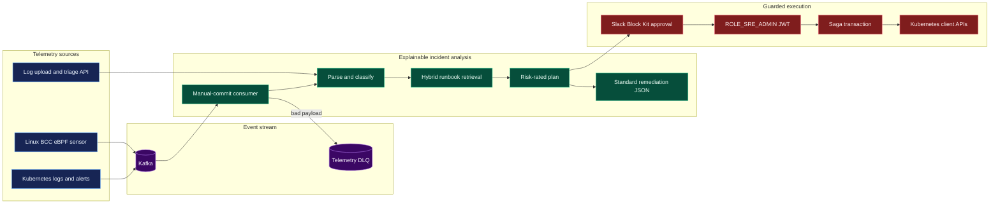

<div align="center">

# ⚡ OpsPulse AI

### Autonomous Kubernetes Incident Remediation Platform · Real-Time Kafka Telemetry · HITL Security Gate

[](https://python.org)
[](https://fastapi.tiangolo.com)
[](https://langchain-ai.github.io/langgraph)
[](https://kafka.apache.org)
[](https://kubernetes.io)
[](https://qdrant.tech)
[](https://streamlit.io)
[](tests/)
[](LICENSE)
[](https://github.com/SumedhPatil1507/opspulse-ai)

**OpsPulse AI** is a production-grade, agentic SRE incident response system that continuously streams cluster telemetry from Kafka, detects anomalous error spikes, retrieves relevant runbooks via hybrid RAG, plans remediations with LLMs, and safely executes Kubernetes cluster actions (`AppsV1Api`, `CoreV1Api`, `Helm`) behind Human-In-The-Loop (HITL) and cryptographic JWT authorization gates.

[**Live Dashboard**](#-interactive-streamlit-command-center) · [**Quick Start**](#-quick-start) · [**Architecture**](#architecture) · [**Kubernetes Action Engine**](#-kubernetes-hitl-action-engine) · [**Kafka Streaming & DLQ**](#-real-time-kafka-event-streaming) · [**Benchmark Suite**](#-10-benchmark-kubernetes-chaos-scenarios)

<a href="#-interactive-streamlit-command-center">Open the dashboard guide ↓</a> · <a href="#-quick-start">Run locally</a> · <a href="#-architecture">Explore the pipeline</a>

> 📦 **Repository:** https://github.com/SumedhPatil1507/opspulse-ai

</div>

---

## ✨ Key Capabilities

| Subsystem | Capability |
|---|---|
| 📡 **Kafka streaming** | Manual offset commits, LangGraph triage, and poison-message quarantine in `k8s.telemetry.dlq`. |
| 🧠 **Explainable RCA** | LangGraph workflows with hybrid dense + BM25 runbook search and risk-rated recommendations. |
| 🛡️ **Kubernetes actions** | Official `kubernetes.client` APIs for restarts, scaling, route shifts, rollback, and log retrieval. |
| 🔐 **Safety gates** | `ROLE_SRE_ADMIN` JWT validation, HITL approval, anti-replay, and Saga compensation. |
| 🐝 **Kernel telemetry** | BCC eBPF probes publish syscall and socket-drop events to Kafka. |
| 📊 **Interactive cockpit** | Streamlit dashboards with Plotly hover, zoom, pan, and modebar controls. |
| 🧪 **Chaos simulation** | Ten Kubernetes outage scenarios stream to Kafka for end-to-end exercises. |

---

## Architecture


---

## 🛡️ Kubernetes HITL Action Engine

All cluster mutations are executed via [`src/k8s_executor.py`](src/k8s_executor.py), requiring two non-bypassable security gates:

1. **Cryptographic JWT Gate**: Verifies JWT signature and checks for `ROLE_SRE_ADMIN` claim.
2. **HITL Review Queue Gate**: Verifies that the action has an explicit `approval_id` in `APPROVED` status with matching action type and target resource.
3. **Anti-Replay Protection**: Immediately transitions approval state to `EXECUTED` upon execution.

High-risk, critical, and unknown-risk plans are sent as Slack Block Kit approval requests. They remain held if Slack is unavailable, and dispatch requires both an approved HITL request and a verified, unexpired `ROLE_SRE_ADMIN` JWT. The workflow and executor each validate the JWT before any Kubernetes API mutation.

```python
from src.k8s_executor import (
    restart_deployment, scale_deployment, rollback_helm_release, fetch_pod_logs,
)

# Execute rolling restart with HITL authorization
result = restart_deployment(
    namespace="production",
    deployment_name="payment-processor",
    auth_token="Bearer eyJhbGciOiJIUzI1NiIs...",
    approval_id="hitl-84bf92a10c",
)
print(result.success, result.duration_ms, result.details)
```

---

## 📡 Real-time Kafka Event Streaming

The streaming consumer in [`src/streaming/kafka_consumer.py`](src/streaming/kafka_consumer.py) operates with **at-least-once delivery guarantees** across two topics — `k8s.pod.logs` (container/app logs) and `k8s.system.alerts` (kubelet/CoreDNS control-plane alerts):

* **Manual Offset Commits**: `enable.auto.commit=False` ensures offsets are committed **only after LangGraph triage succeeds** (or the record is quarantined in the DLQ) — a crash mid-triage redelivers instead of losing the record.
* **Dead Letter Queue (`k8s.telemetry.dlq`)**: Corrupted JSON or schema validation failures are immediately quarantined into the DLQ topic with diagnostic metadata, keeping the consumer partition moving.
* **Error Spike Detector**: Tracks error frequencies per service/pod over a sliding window (default: 5 errors in 60s) to automatically trigger the LangGraph RCA workflow; critical system alerts triage immediately without waiting for a spike.

Offsets are committed synchronously only after LangGraph processing succeeds or the record has been synchronously published to `k8s.telemetry.dlq`.

### Saga remediation and compensation

[`src/agent/saga_orchestrator.py`](src/agent/saga_orchestrator.py) runs remediation steps as a Saga: completed steps are compensated in reverse order when a later step or rollback-state invariant fails. Scale actions capture the prior replica count, deployment restarts capture the prior pod-template annotations, pod restarts retain the pod manifest, and route shifts capture the Service selector. Compensation outcomes and transaction IDs are included in the workflow execution result and trace.

The remediation operations `restart_pod` and `route_shift` use the same JWT and HITL approval gates as deployment restart and scaling. A pod restart is compensatable by recreating the captured pod manifest; Kubernetes controllers may also independently recreate controller-managed pods.

Run it standalone:

```bash
python -m src.streaming.kafka_consumer
```

### Linux eBPF kernel telemetry

[`src/telemetry/ebpf_sensor.py`](src/telemetry/ebpf_sensor.py) attaches BCC
tracepoints for `sys_enter_connect`, `sys_enter_execve`, and `skb:kfree_skb`
(including the kernel drop reason when the running kernel exposes it). Events
are emitted as JSON to `k8s.ebpf.kernel.telemetry`.

Run this sensor on a Linux node with BCC, kernel headers/toolchain, Kafka
connectivity, and `confluent-kafka` installed. The process needs root or the
kernel capabilities required to load BPF programs and open perf buffers. BCC
is intentionally not installed by the dashboard requirements.

```bash
python -m src.telemetry.ebpf_sensor --bootstrap-servers localhost:9092
```

The event contains host, PID, UID, process name, syscall arguments, and (for
execve) the executable filename. Connect's sockaddr is represented by its
userspace pointer and length; the sensor does not dereference process memory.

---

## 📂 Dual Ingestion Engine (Live Kafka + File Uploads)

| Path | Endpoint / Module | Input | Output |
|---|---|---|---|
| Live stream | `src/streaming/kafka_consumer.py` | Kafka `k8s.pod.logs`, `k8s.system.alerts` | LangGraph triage → DLQ on failure |
| File upload | `POST /api/v1/logs/upload` | `.log` / `.txt` stack traces + `.md` runbooks | `RemediationReport` + Qdrant index results |
| JSON triage | `POST /api/v1/triage` | `{"raw_log_stacktrace": "..."}` | `RemediationReport` |

```bash
# Triage an uploaded stack trace
curl -X POST http://localhost:8000/api/v1/logs/upload \
  -F "files=@incident.log"

# Upload a runbook — indexed into Qdrant on the fly
curl -X POST http://localhost:8000/api/v1/logs/upload \
  -F "files=@disk_full_runbook.md"

# Standardized triage from JSON
curl -X POST http://localhost:8000/api/v1/triage \
  -H "Content-Type: application/json" \
  -d '{"raw_log_stacktrace": "java.lang.OutOfMemoryError: Java heap space ..."}'
```

---

## 🧾 Standardized Explainable Remediation JSON

**Every** incident triage API response (`/api/v1/triage`, and the `triage` block of `/api/v1/logs/upload`) returns exactly this contract — a stable schema for dashboards, chat-ops, and automation:

```json
{
  "verdict": "CRITICAL OOMKILLED CASCADE DETECTED",
  "reasoning": "Root-cause analysis matching stack trace lines with runbook similarity scores (rerank_score, dense_score, rrf_score).",
  "recommendation": "[HIGH] Scale Deployment Replicas to 5",
  "next_steps": [
    "Step 1: Review active memory usage on Prometheus Grafana dashboard",
    "Step 2: Execute kubectl command or click Approve to trigger automated K8s restart",
    "Step 3: Update application memory limit in Helm values repository"
  ]
}
```

* `verdict` — severity + classified failure signature + cascade detection.
* `reasoning` — matched stack lines woven with the exact runbook similarity scores that justified the verdict.
* `recommendation` — risk-tier-prefixed (`[LOW]`…`[CRITICAL]`) remediation from the planner.
* `next_steps` — ordered operator runbook: diagnose → execute/approve → prevent.

---

## 🧪 10 Benchmark Kubernetes Chaos Scenarios

Located in [`incident-simulation/data/`](incident-simulation/data/) and streamable into Kafka via [`scripts/simulate_k8s_outages.py`](scripts/simulate_k8s_outages.py):

| ID | Scenario | Category | Target | Recommended action |
|---|---|---|---|---|
| **INC-001** | Cascading OOMKilled memory leak | `RESOURCE_EXHAUSTION` | `deployment/payment-processor` | Raise memory limit and rolling restart |
| **INC-002** | CrashLoopBackOff (missing Secret) | `CONFIGURATION_ERROR` | `deployment/auth-service` | Restore `JWT_SIGNING_KEY` and restart |
| **INC-003** | CoreDNS resolution timeout storm | `NETWORK_INFRASTRUCTURE` | `deployment/coredns` | Scale CoreDNS replicas to 6 |
| **INC-004** | PersistentVolume disk full | `STORAGE_EXHAUSTION` | `statefulset/event-store-db` | Expand PVC storage |
| **INC-005** | CPU throttling and p99 latency spike | `CPU_SATURATION` | `deployment/checkout-api` | Adjust CPU requests and limits |
| **INC-006** | Ingress TLS certificate expiry | `SECURITY_CERTIFICATE` | `ingress/api-gateway-ingress` | Renew the ACME certificate |
| **INC-007** | Node NotReady with disk pressure | `NODE_DEGRADATION` | `node/gke-prod-pool-node-3b` | Inspect node pressure and recover capacity |
| **INC-008** | HikariCP connection pool starvation | `DATABASE_CONTENTION` | `deployment/order-service` | Tune the connection pool |
| **INC-009** | Istio mTLS handshake errors | `SERVICE_MESH` | `deployment/billing-service` | Refresh sidecar credentials and restart |
| **INC-010** | Readiness probe misconfiguration | `DEPLOYMENT_MISCONFIG` | `deployment/notification-dispatcher` | Correct the probe port |

---

## 📊 Interactive Streamlit Command Center

The dashboard runs standalone or connected to live Prometheus / Kafka endpoints:

```powershell
streamlit run streamlit_app.py
```

### Dashboard Tabs
1. **SRE Operations Cockpit**: Real-time MTTR, incident rate, error spike frequency, and health breakdown.
2. **Interactive Chaos & RCA Simulator**: Live replay of all 10 Kubernetes benchmark scenarios with step-by-step LangGraph multi-agent diagnostic trace inspection, interactive metrics visualization, and confidence scoring.
3. **Kubernetes HITL Action Engine**: Guarded action dispatcher with SRE JWT token validator and HITL approval queue.
4. **Real-time Kafka & DLQ Stream**: Live event streaming inspector with Dead Letter Queue quarantine monitor.
5. **AI Triage & Log Upload**: Drag-and-drop `.log`/`.txt`/`.md` ingestion, standardized remediation report viewer, paste-to-triage, and interactive Plotly verdict charts.

### Chaos Benchmark Streaming (Kafka stress test)

Stream all 10 multi-pod failure scenarios (OOMKilled cascades, CrashLoopBackOff, CoreDNS timeouts, …) into Kafka to stress-test the agent's root-cause analysis:

```bash
# List the scenarios
python scripts/simulate_k8s_outages.py --list

# Stream everything at 20 msg/s into k8s.pod.logs + k8s.system.alerts
python scripts/simulate_k8s_outages.py --rate 20

# Only OOM + CoreDNS + CrashLoop, plus poison records to exercise the DLQ
python scripts/simulate_k8s_outages.py --scenario 1 --scenario 2 --scenario 3 --with-poison

# No Kafka broker? Inspect the exact records that would be produced
python scripts/simulate_k8s_outages.py --dry-run --scenario 1
```

### Incident Simulation Framework

The project includes a comprehensive **Principal SRE-grade incident simulation framework** in the `incident-simulation/` directory for testing and validating OpsPulse AI's incident detection and diagnostic capabilities.

#### Framework Overview

This benchmark framework provides:
- **10 Realistic Kubernetes Cluster Incidents** with detailed log streams and metrics formatted as raw JSON
- **LangGraph Multi-Agent Diagnostic Traces** for each incident, showing step-by-step root-cause analysis
- **Benchmark Test Inputs** formatted as raw JSON for easy integration
- **Confidence Scoring** and remediation recommendations for each incident
- **Interactive Streamlit Visualization** with:
  - Real-time metrics time-series charts (Plotly - fully interactive)
  - Log level distribution pie charts
  - Interactive log stream explorer with filtering
  - Step-by-step LangGraph agent trace visualization
  - Confidence scoring with visual progress bars
  - Remediation recommendations with priority levels

#### Incident Catalog

| ID | Type | Namespace | Complexity | Overall Confidence | Category |
|----|------|-----------|------------|-------------------|----------|
| INC-2026-001 | Cascading OOMKilled | payment-service | High | 0.94 | Resource Exhaustion |
| INC-2026-002 | CrashLoopBackOff Missing Secret | auth-service | Medium | 0.96 | Configuration Error |
| INC-2026-003 | CoreDNS Resolution Timeout | kube-system | High | 0.93 | Network Infrastructure |
| INC-2026-004 | PersistentVolume Disk Full | database | High | 0.95 | Storage Exhaustion |
| INC-2026-005 | CPU Throttling | api-service | Medium | 0.95 | CPU Saturation |
| INC-2026-006 | ImagePullBackOff Registry Unavailable | order-service | Medium | 0.93 | Registry Connectivity |
| INC-2026-007 | Network Policy Connection Blocked | microservices | Medium | 0.96 | Network Security |
| INC-2026-008 | Resource Quota Exceeded | development | Low | 0.96 | Resource Management |
| INC-2026-009 | Node NotReady Disk Pressure | all-namespaces | Medium | 0.95 | Node Health |
| INC-2026-010 | HPA Scale Failure | web-frontend | Medium | 0.94 | Autoscaling |

#### Usage

**Running the Interactive Streamlit Dashboard:**

```bash
streamlit run streamlit_app.py
```

Navigate to the **"⚡ Interactive Chaos & RCA Simulator"** tab to:
1. Select any of the 10 benchmark incidents from the dropdown
2. Click "🚀 Trigger Simulation & RCA" to replay the incident
3. View interactive metrics visualizations with Plotly charts
4. Explore the log stream with filtering capabilities
5. Inspect the step-by-step LangGraph multi-agent diagnostic trace
6. Review confidence scores and remediation recommendations

**Programmatic Usage:**

```python
from src.agent.workflow import run_workflow
from src.agent.reporting import build_remediation_report

# Run the LangGraph triage pipeline on an alert payload
state = run_workflow({
    "alert_id": "manual-001",
    "service_name": "payment-service",
    "severity": "critical",
    "raw_log_stacktrace": "java.lang.OutOfMemoryError: Java heap space ...",
    "environment": "production",
})

# Standardized explainable remediation JSON
report = build_remediation_report(state)
print(report.verdict)          # e.g. "CRITICAL OOMKILLED CASCADE DETECTED"
print(report.recommendation)   # e.g. "[HIGH] Scale Deployment Replicas to 5"
for step in report.next_steps:
    print(step)

# Stream the 10 benchmark scenarios into Kafka:
#   python scripts/simulate_k8s_outages.py --rate 20
```

For detailed documentation, see [`incident-simulation/docs/README.md`](incident-simulation/docs/README.md) and [`incident-simulation/docs/incident_catalog.md`](incident-simulation/docs/incident_catalog.md).

---

## 🚀 Quick Start

### 1. Clone & Setup Environment

```bash
git clone https://github.com/SumedhPatil1507/opspulse-ai.git
cd opspulse-ai

# Create virtual environment
python -m venv .venv

# Windows
.venv\Scripts\Activate.ps1
# Linux / macOS
source .venv/bin/activate

# Install the API, Kafka, Kubernetes, AI and dashboard dependencies
pip install -r requirements-full.txt
```

### 2. Configure Environment Variables

```bash
cp .env.example .env
```

Set the required values in `.env` (use your own unique JWT secret):
```env
GROQ_API_KEY=gsk_your_groq_api_key
KAFKA_BOOTSTRAP_SERVERS=localhost:9092
JWT_SECRET_KEY=<unique-secret-at-least-32-characters>
```

Generate a suitable JWT secret with:

```bash
python -c "import secrets; print(secrets.token_urlsafe(48))"
```

Start Kafka and Qdrant before enabling their integrations. The dashboard can
still be explored in demo mode without those services; live upload/triage
requires the API and its configured model/vector dependencies.

### 3. Launch the API and interactive Streamlit dashboard

In two terminals from the project root:

```bash
# Terminal 1: API
uvicorn src.api.app:app --reload --host 0.0.0.0 --port 8000

# Terminal 2: interactive SRE dashboard
streamlit run streamlit_app.py
```

Open the Streamlit URL printed in the terminal (usually `http://localhost:8501`).
Set **FastAPI Base URL** in the sidebar if the API runs on another host. The
dashboard includes interactive Plotly charts, Kafka/DLQ inspection, outage
scenarios, JWT/HITL action controls, drag-and-drop `.log` / `.txt` / `.md`
ingestion, and a JSON triage view. `requirements.txt` contains only the lighter
dashboard dependencies; use `requirements-full.txt` for the API and integrations.

### 4. Run Test Suite

```powershell
# Run the full 116-test suite
pytest -v

# Run individual subsystems
pytest tests/test_k8s_executor.py -v      # K8s executor + JWT/HITL safety gates
pytest tests/test_kafka_consumer.py -v    # Manual offsets + DLQ routing
pytest tests/test_triage_api.py -v        # Standardized remediation JSON contract
pytest tests/test_api.py -v               # Alert ingestion & validation
```

---

## 📂 Project Structure

```
opspulse-ai/
├── data/
│   └── runbooks/                   ← Markdown SRE runbooks (Qdrant hybrid RAG)
│
├── src/
│   ├── agent/                      ← LangGraph multi-agent state machine
│   │   ├── nodes.py                ← 7 nodes (Parse, Retrieve, Plan, HITL, Execute…)
│   │   ├── state.py                ← IncidentState TypedDict + reducers
│   │   ├── workflow.py             ← StateGraph compilation & JWT-gated routing
│   │   ├── reporting.py            ← Standardized RemediationReport builder
│   │   └── slack_client.py         ← Slack Block Kit HITL interactive webhook
│   │
│   ├── api/                        ← FastAPI service & routing
│   │   ├── app.py                  ← FastAPI factory & OpenAPI docs
│   │   ├── core/config.py          ← Pydantic v2 Settings (Kafka, K8s, JWT, Redis)
│   │   ├── models/remediation.py   ← RemediationReport contract (verdict/…/next_steps)
│   │   └── routes/
│   │       ├── alerts.py           ← POST /api/v1/alerts/ingest (+ batch)
│   │       ├── logs.py             ← POST /api/v1/logs/upload · POST /api/v1/triage
│   │       └── runbooks.py         ← POST /api/v1/runbooks/upload
│   │
│   ├── k8s_executor.py             ← AppsV1Api/CoreV1Api HITL executor (JWT-gated)
│   ├── streaming/
│   │   └── kafka_consumer.py       ← Manual-offset consumer + DLQ + LangGraph triage
│   ├── metrics.py                  ← Prometheus metrics registry & ASGI /metrics
│   └── worker/tasks.py             ← Celery async alert processing tasks
│
├── scripts/
│   └── simulate_k8s_outages.py     ← Streams 10 chaos scenarios into Kafka
│
├── tests/
│   ├── test_k8s_executor.py        ← K8s API mocks + JWT/HITL safety-gate tests
│   ├── test_kafka_consumer.py      ← Manual offset commit + DLQ tests
│   ├── test_triage_api.py          ← Standardized JSON contract + upload tests
│   └── test_api.py                 ← FastAPI ingestion & validation tests
│
├── incident-simulation/            ← Principal SRE-grade incident simulation framework
│   ├── data/                       ← 10 realistic Kubernetes incident log streams
│   ├── traces/                     ← LangGraph multi-agent diagnostic traces
│   └── docs/                       ← Documentation and usage examples
│
├── dashboard.py                    ← Streamlit SRE command center
├── streamlit_app.py                ← Streamlit entry point
├── requirements.txt                ← Lightweight dependencies
└── requirements-full.txt           ← Full production dependencies
```

---

## 📜 License

Distributed under the **MIT License**. See [LICENSE](LICENSE) for more information.

---

<div align="center">
Built with ❤️ using LangGraph · Kafka · Kubernetes · FastAPI · Streamlit
</div>
